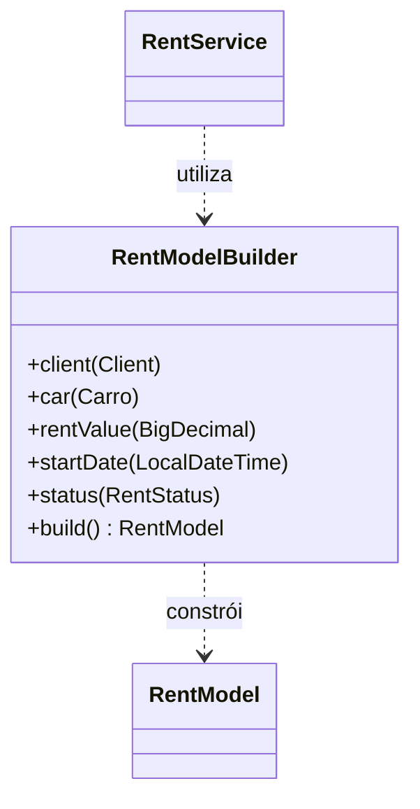
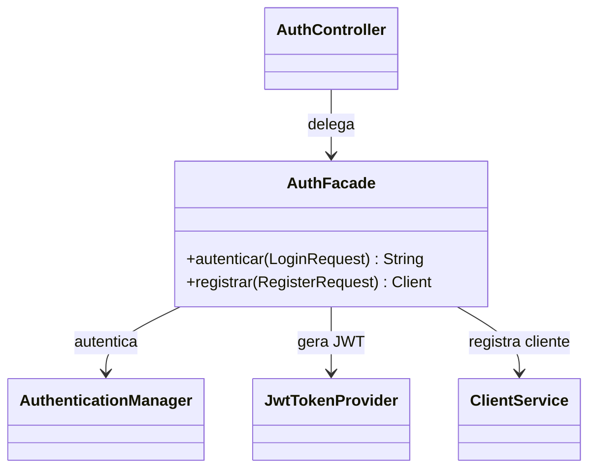
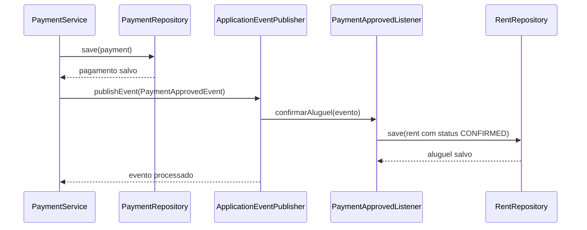

# 🚗 CarRental API

API REST para um sistema conceito de aluguel de carros, desenvolvida como projeto acadêmico.

## 📋 Sobre o projeto
Sistema back-end que gerencia clientes, veículos e locações (aluguéis), com regras de negócio para controle de disponibilidade, cálculo de valores, status de reserva e finalização do aluguel.

## 🛠️ Stack
- **Java 17+**
- **Spring Boot 4.x** (Web, Data JPA, Validation, Security, OAuth2 Client)
- **PostgreSQL**
- **Maven**
- **JWT** (jjwt) para tokens de acesso
- **H2** para testes

## 👥 Equipe
| Membro | Papel |
|---|---|
| **Rossini (Roberto Rossini)** | Dev responsável pela parte "pesada": arquitetura, regras de negócio, entidade central de Aluguel, integrações entre módulos |
| **Ronaldo Malta** | Dev iniciante em Java — CRUD de entidade simples (Cliente) |
| **Pedro Vieira** | Dev iniciante em Java — CRUD de entidade simples (Carro) |
| **Alexandre** | Dev iniciante em Java — Módulo de Cadastro/gestão administrativa e suporte às regras do sistema |

## 🧩 Divisão de tarefas

### 🔴 Rossini — Módulo de Aluguel (core do sistema)
- Modelagem da entidade `Aluguel` (relaciona Cliente + Carro)
- Regras de negócio: verificação de disponibilidade do carro, cálculo de valor total, datas de retirada/devolução
- Endpoints: criar aluguel, finalizar aluguel, listar aluguéis por cliente/carro
- Validações e tratamento de exceções (`GlobalExceptionHandler`)
- Configuração inicial do projeto (estrutura de pacotes, `application.properties`, conexão com o banco)
- Documentação da API (Swagger/OpenAPI)

### 🟢 Ronaldo — Módulo de Cliente, Front-end e DevOps
* Entidade `Client` (nome, CPF, telefone, email, endereço)
* CRUD completo (`ClienteController`, `ClienteService`, `ClienteRepository`)
* Validações básicas de campos (CPF, email)
* Testes manuais via Postman/Insomnia
* Desenvolvimento e integração do front-end da aplicação
* Configuração e organização das rotas da aplicação
* Criação da pipeline CI/CD do projeto
* Automação de build e testes utilizando GitHub Actions

### 🟡 Pedro — Módulo de Carro
- Entidade `Carro` (modelo, placa, categoria, valor da diária, status de disponibilidade)
- CRUD completo (`CarroController`, `CarroService`, `CarroRepository`)
- Endpoint para listar apenas carros disponíveis
- Testes manuais via Postman/Insomnia

### 🔵 Alexandre — Módulo Administrativo
- Apoio à modelagem e manutenção das entidades de apoio ao sistema
- Organização de rotinas administrativas e documentação complementar do projeto
- Suporte às validações e às regras de negócio do fluxo principal

## 🗂️ Estrutura do projeto
```text
v1/src/main/java/Veloce_Rent_a_Car/
├── config/           (SecurityConfig, OAuth2SecurityConfig, OpenApiConfig, DatabaseInitializer)
├── controllers/      (Auth, Client, Carro, Rent, Payment, CarroCsv)
├── dto/              (ClientDTO, LoginRequest, RegisterRequest, NewRentDTO, NewPaymentDTO)
├── events/           (PaymentApprovedEvent)
├── exception/        (GlobalExceptionHandler e exceções customizadas)
├── listeners/        (PaymentApprovedListener)
├── models/           (Client, Carro, RentModel, Payment + enums)
├── repositories/     (JpaRepository interfaces)
├── security/         (JWT, autenticação e integração OAuth2)
├── service/          (CarroCsvService)
├── services/         (AuthFacade, Client, Carro, Rent e Payment Services)
└── v1/V1Application.java
```

## 🧱 Padrões de Projeto Utilizados

Os padrões abaixo foram aplicados a necessidades já existentes no código, sem alterar as rotas ou os formatos de sucesso das respostas REST.

### 1. Builder

- **Categoria:** criacional.
- **Problema que resolve:** a criação de `RentModel`, `Payment`, `Client` e `Carro` estava espalhada por sequências de `new` e setters. Isso tornava a inicialização menos legível e facilitava omitir campos obrigatórios ou valores iniciais.
- **Por que é adequado:** as entidades possuem vários campos e são criadas em fluxos diferentes. O Builder deixa cada atribuição explícita e mantém os construtores e setters necessários para JPA, testes e serialização.
- **Onde está no código:**
  - `models/RentModel.java`, `models/Payment.java`, `models/Client.java` e `models/Carro.java`: `@Builder` do Lombok;
  - `services/RentService.java`: criação de aluguéis;
  - `services/PaymentService.java`: criação de pagamentos;
  - `services/AuthFacade.java`: criação de clientes no cadastro;
  - `service/CarroCsvService.java`: criação de carros importados do CSV.

**Antes — construção do aluguel:**
```java
RentModel rent = new RentModel();
rent.setClient(client);
rent.setCar(carro);
rent.setRentValue(dto.getRentValue());
rent.setStartDate(LocalDateTime.now());
rent.setStatus(RentModel.RentStatus.PENDING);
```

**Depois — construção fluente:**
```java
RentModel rent = RentModel.builder()
        .client(client)
        .car(carro)
        .rentValue(dto.getRentValue())
        .startDate(LocalDateTime.now())
        .status(RentModel.RentStatus.PENDING)
        .build();
```

**Diagrama simplificado** (o builder é gerado pelo Lombok):


### 2. Facade

- **Categoria:** estrutural.
- **Problema que resolve:** `AuthController` conhecia e coordenava `AuthenticationManager`, `JwtTokenProvider` e `ClientService`, além de montar a entidade `Client`. O controller acumulava regras do subsistema de autenticação em vez de apenas tratar HTTP.
- **Por que é adequado:** `AuthFacade` oferece uma entrada única e simples para as operações de autenticação e cadastro, ocultando a colaboração entre os componentes do subsistema.
- **Onde está no código:**
  - `services/AuthFacade.java`: métodos `autenticar` e `registrar`;
  - `controllers/AuthController.java`: delega as operações à Facade e mantém `/api/auth/login` e `/api/auth/register`;
  - `dto/LoginRequest.java` e `dto/RegisterRequest.java`: contratos de entrada fora da camada de controller.

**Antes — controller coordenando o subsistema:**
```java
Authentication authentication = authenticationManager.authenticate(
        new UsernamePasswordAuthenticationToken(
                request.getCpf(), request.getPassword())
);
UserDetails userDetails = (UserDetails) authentication.getPrincipal();
String token = jwtTokenProvider.generateToken(userDetails);
```

**Depois — controller utilizando a Facade:**
```java
String token = authFacade.autenticar(request);
```

No login, somente `BadCredentialsException` produz a resposta 401 já existente. Erros inesperados não são mais convertidos incorretamente em “Credenciais inválidas”.



### 3. Observer

- **Categoria:** comportamental.
- **Problema que resolve:** após salvar um pagamento, `PaymentService` também alterava e salvava o aluguel. A confirmação do aluguel era uma consequência acoplada diretamente ao fluxo de pagamento.
- **Por que é adequado:** o pagamento aprovado é um fato do domínio. Com Observer, o serviço publica esse fato e os interessados reagem sem que o pagamento precise conhecer todas as suas consequências. Novos listeners podem ser adicionados sem modificar o fluxo principal.
- **Onde está no código:**
  - `events/PaymentApprovedEvent.java`: evento que carrega o pagamento aprovado;
  - `services/PaymentService.java`: publica o evento por `ApplicationEventPublisher`;
  - `listeners/PaymentApprovedListener.java`: observa o evento e confirma o aluguel.

**Antes — efeito colateral dentro do serviço de pagamento:**
```java
Payment saved = paymentRepository.save(payment);
rent.setStatus(RentModel.RentStatus.CONFIRMED);
rentRepository.save(rent);
return saved;
```

**Depois — publicação e reação ao evento:**
```java
Payment saved = paymentRepository.save(payment);
eventPublisher.publishEvent(new PaymentApprovedEvent(saved));
return saved;
```

```java
@EventListener
public void confirmarAluguel(PaymentApprovedEvent event) {
    RentModel rent = event.payment().getRent();
    rent.setStatus(RentModel.RentStatus.CONFIRMED);
    rentRepository.save(rent);
}
```

Os eventos do Spring são síncronos por padrão nesta configuração. Assim, a confirmação continua ocorrendo antes do retorno de `PaymentService.create`, como acontecia antes da refatoração.



## ▶️ Como rodar o projeto

### Pré-requisitos
- Java 17+
- Maven 3.9+
- PostgreSQL 14+ (ou use o profile de teste com H2)

### Configuração
```bash
# clonar o repositório
git clone <url-do-repo>
cd Veloce-Rent-a-Car/v1

# configurar variáveis de ambiente (não comite secrets!)
export SPRING_DATASOURCE_URL=jdbc:postgresql://localhost:5432/carrental
export SPRING_DATASOURCE_USERNAME=postgres
export SPRING_DATASOURCE_PASSWORD=postgres
export APP_JWT_SECRET="sua-chave-secreta-de-pelo-menos-256-bits"
export APP_JWT_EXPIRATION=86400000

# OAuth2 Google (opcional - para login com Google)
export OAUTH2_GOOGLE_CLIENT_ID="seu-client-id.apps.googleusercontent.com"
export OAUTH2_GOOGLE_CLIENT_SECRET="seu-client-secret"

# rodar com Maven
./mvnw spring-boot:run
```

### Perfil de teste (H2 em memória)
```bash
./mvnw spring-boot:run -Dspring-boot.run.profiles=test
```

## 🧪 Como rodar os testes
```bash
# todos os testes
./mvnw test

# teste específico
./mvnw test -Dtest=ClientServiceTest

# com coverage (JaCoCo)
./mvnw verify jacoco:report
# relatório em target/site/jacoco/index.html
```

## 🔐 Autenticação

### Login com usuário/senha (JWT)
```bash
# Registrar cliente
curl -X POST http://localhost:8080/api/auth/register \
  -H "Content-Type: application/json" \
  -d '{"nome":"João","cpf":"12345678901","telefone":"11999999999","email":"joao@email.com","endereco":"SP","password":"123456"}'

# Login
curl -X POST http://localhost:8080/api/auth/login \
  -H "Content-Type: application/json" \
  -d '{"cpf":"12345678901","password":"123456"}'

# Response: {"token":"eyJhbGciOiJIUzI1NiJ9...","type":"Bearer"}
```

### Login com Google (OAuth2) — opcional
Requer configuração no **Google Cloud Console**:
1. Crie um projeto → APIs & Services → Credentials → OAuth 2.0 Client ID
2. Authorized redirect URI: `http://localhost:8080/login/oauth2/code/google`
3. Defina as variáveis `OAUTH2_GOOGLE_CLIENT_ID` e `OAUTH2_GOOGLE_CLIENT_SECRET`

Fluxo:
1. Acesse `http://localhost:8080/oauth2/authorization/google`
2. Faça login no Google
3. Retorna JSON com nosso JWT: `{"token":"...","type":"Bearer"}`

### Usando o token (Authorization Header)
```bash
curl -H "Authorization: Bearer <SEU_TOKEN>" http://localhost:8080/api/clients
```

## 📌 Endpoints principais

### Clientes (`/api/clients`)
| Método | Endpoint | Descrição |
|---|---|---|
| GET | `/` | Listar todos |
| GET | `/{id}` | Buscar por ID |
| GET | `/cpf/{cpf}` | Buscar por CPF |
| POST | `/` | Criar (público) |
| PUT | `/{id}` | Atualizar |
| DELETE | `/{id}` | Deletar |

### Carros (`/api/carros`)
| Método | Endpoint | Descrição |
|---|---|---|
| GET | `/` | Listar todos |
| GET | `/disponiveis` | Listar disponíveis |
| GET | `/{id}` | Buscar por ID |
| POST | `/` | Criar |
| PUT | `/{id}` | Atualizar |
| DELETE | `/{id}` | Deletar |
| GET | `/csv/export` | Exportar CSV |
| POST | `/csv/import` | Importar CSV (multipart) |

### Aluguéis (`/api/rentals`)
| Método | Endpoint | Descrição |
|---|---|---|
| GET | `/` | Listar todos |
| GET | `/{id}` | Buscar por ID |
| GET | `/client/{clientId}` | Listar por cliente |
| POST | `/` | Criar aluguel |
| PATCH | `/{id}/status` | Atualizar status |

### Pagamentos (`/payments`)
| Método | Endpoint | Descrição |
|---|---|---|
| GET | `/` | Listar todos |
| GET | `/{id}` | Buscar por ID |
| GET | `/rent/{rentId}` | Listar por aluguel |
| POST | `/` | Criar pagamento |

## 📦 Exceções customizadas
| Exceção | HTTP Status | Quando ocorre |
|---|---|---|
| `RecursoNaoEncontradoException` | 404 | Recurso não existe |
| `RegraDeNegocioException` | 409 | Violação de regra (ex: CPF duplicado, aluguel já pago) |
| `ValidacaoException` | 400 | Dados de entrada inválidos |
| `MethodArgumentNotValidException` | 400 | Validação de campos (@Valid) |

Resposta padrão:
```json
{
  "timestamp": "2026-11-09T18:00:00Z",
  "status": 404,
  "error": "Not Found",
  "message": "Cliente nao encontrado com id: 999",
  "path": "/api/clients/999"
}
```

## 📚 Documentação
| Documento | Descrição |
|---|---|
| [API Reference](docs/API.md) | Endpoint, modelos, DTOs, regras de negócio e exemplos de uso |
| [TODO / Roadmap](TODO.md) | Lista de tarefas priorizadas (crítico → baixo) |
| [Quickstart](docs/QUICKSTART.md) | Guia rápido de execução |

### Etapa 1 — Proposta e Escopo
| Documento | Descrição |
|---|---|
| [Proposta do Sistema](docs/etapa1/proposta.md) | Apresentação e objetivo do projeto |
| [Diagrama de Casos de Uso](docs/etapa1/diagrama-casos-de-uso.md) | Diagrama Mermaid com atores e funcionalidades |
| [Escopo e Domínio](docs/etapa1/escopo.md) | O que o sistema faz e o que não faz |
| [Justificativa Técnica](docs/etapa1/justificativa-tecnica.md) | Por que esse domínio e essa stack |

## 📌 Status
🚧 Em desenvolvimento — projeto acadêmico.
